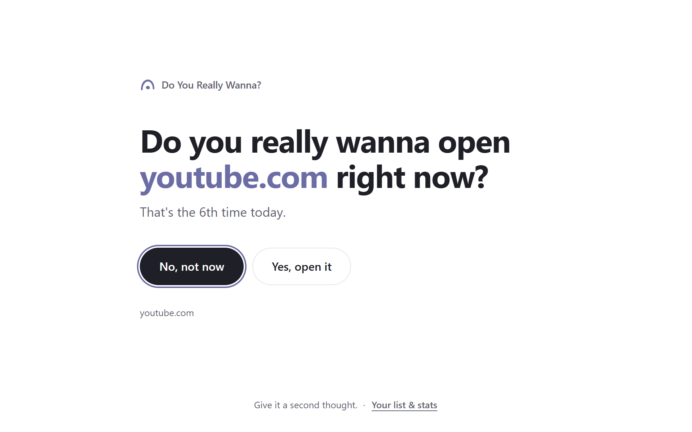
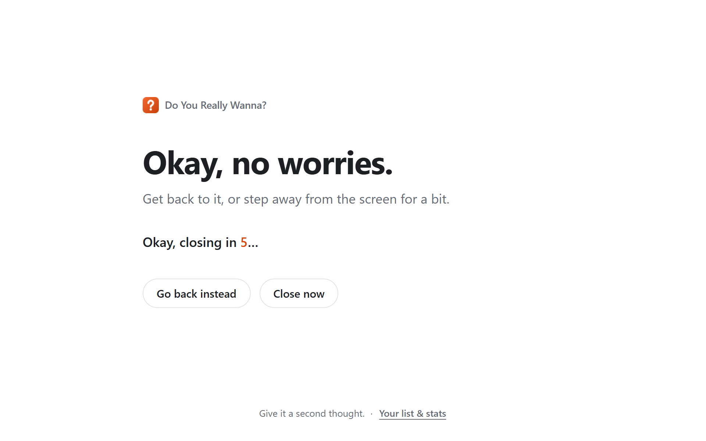
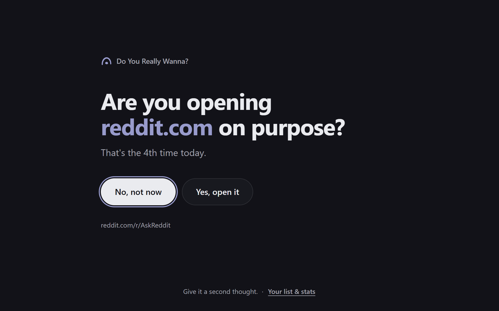
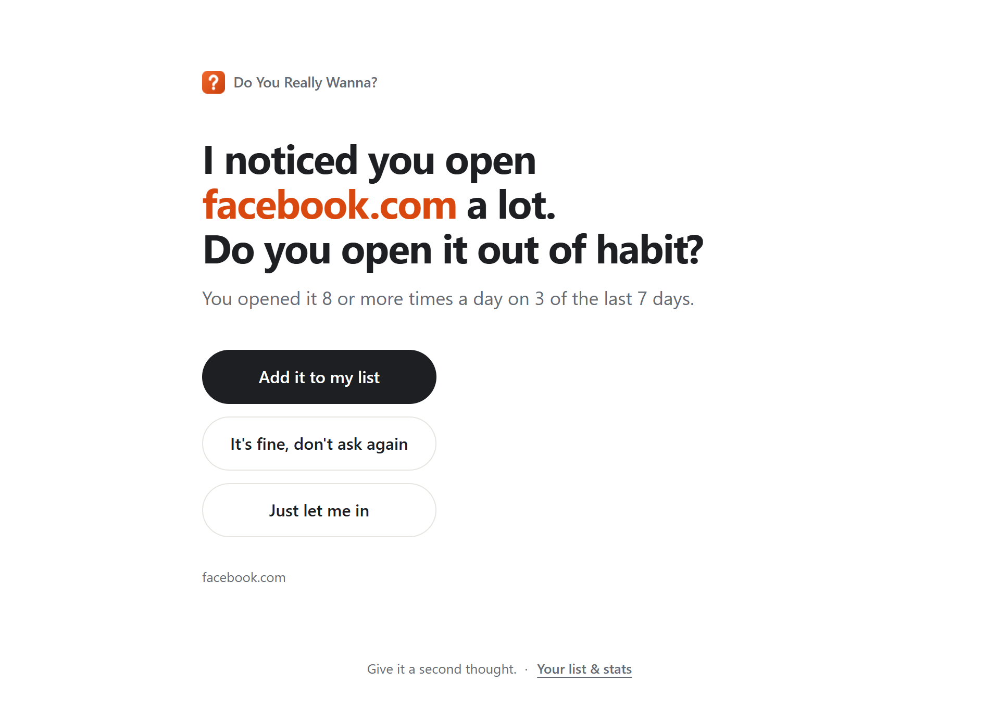
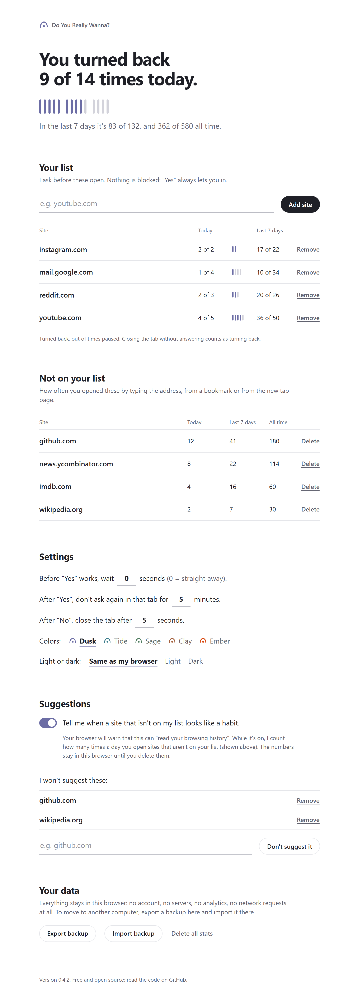
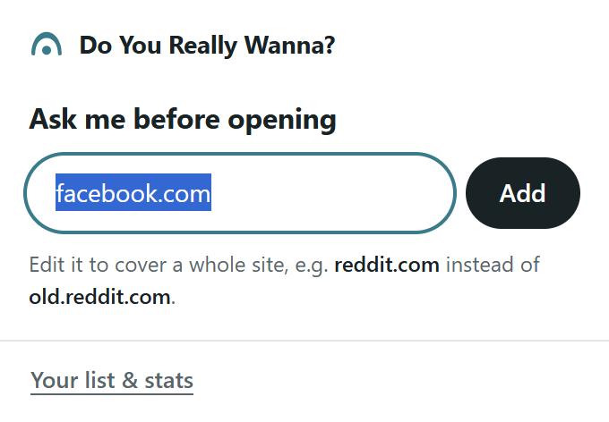

<p align="center">
  
</p>

<h1 align="center">Do You Really Wanna?</h1>

<p align="center">
  <b>Give it a second thought.</b><br />
  A gentle pause before the sites you open on autopilot.<br />
  For Microsoft Edge and Google Chrome. Free, open source, and private.
</p>

<p align="center">
  
</p>

---

## Why

You know the move. You're supposed to be doing something else, or you meant
to get up from the computer, and your hands have already opened YouTube,
Reddit, Instagram or Gmail. You're not looking for anything. You just
scroll.

Blockers don't fit, because you actually *need* those sites sometimes.
Timers don't help either: they interrupt you in the middle of something and
you learn to click them away. And most extensions in this space are paid,
bloated, or want to read everything you do.

**Do You Really Wanna?** doesn't block anything. Right before a site on your
list opens, it asks one question. If you need it, **"Yes"** lets you straight
in. If you were on autopilot, **"No"** closes the tab, kindly. Either way you
had a second to think about *why* you were opening it.

## What it does

- **Asks before a listed site opens.** The site doesn't even load until you
  say yes, so no autoplaying video pulls you in while you decide.
- **Shows you the number.** "That's the 6th time today." Easy to wave away
  once; harder the sixth time.
- **"Yes, open it"** opens the site right away and won't ask again in that
  tab for 5 minutes.
- **"No, not now"** says something kind, counts down "Okay, closing in 5…",
  and closes the tab. It never closes your last tab, and you can go back
  instead.
- **Only asks when you *enter* a site.** Clicking around inside it, or
  opening its links in new tabs, never asks.
- **Keeps score, gently.** How often you turned back today, this week and
  all time, per site.
- **Changes the question** now and then, so it doesn't fade into the
  background.
- **Can suggest sites for your list, if you want.** Turn on suggestions
  and it notices sites you open a lot by typing them, from a bookmark or
  from the new tab page. When one looks like a habit, it asks once:
  **Add it to my list**, **It's fine, don't ask again**, or **Just let me
  in**. Off by default.
- **Moves with you without a cloud.** Export a backup file, import it on
  your other computer.
- **Five calm color themes**, each in light and dark: Dusk, Tide, Sage,
  Clay, and Ember. Light or dark follows your browser, or pick one.

<table>
  <tr>
    <td width="50%"></td>
    <td width="50%"></td>
  </tr>
  <tr>
    <td align="center"><sub>After "No"</sub></td>
    <td align="center"><sub>Dark mode, and a different question</sub></td>
  </tr>
</table>

<p align="center">
  <br />
  <sub>With suggestions on: a site you keep opening that isn't on your list yet</sub>
</p>

<table>
  <tr>
    <td width="62%" valign="top"></td>
    <td width="38%" valign="top"></td>
  </tr>
  <tr>
    <td align="center"><sub>Your list &amp; stats</sub></td>
    <td align="center"><sub>Add the site you're on from the toolbar</sub></td>
  </tr>
</table>

## Privacy

This is the point, not a footnote.

- **Nothing leaves your computer.** The extension makes no network requests
  at all: no servers, no accounts, no analytics, no crash reports. It doesn't
  even use the browser's sync storage, because that goes through
  Google's/Microsoft's servers.
- **It doesn't keep a history.** It stores your list, your settings, and
  per day, per listed site, two numbers (times asked, times opened anyway).
  No web addresses, no page titles, no times of day.
- **Suggestions are opt-in.** Only if you turn them on does it see which
  pages open (your browser will warn about "browsing history"). Even then
  it keeps one number per site per day (how often you opened sites that
  aren't on your list), which you can see and delete on "Your list &
  stats".
- **It only asks for access to the sites you add**, one at a time, when you
  add them, and gives the access back when you remove them. It never runs
  code inside the pages you visit.
- **What's on GitHub is exactly what runs.** No build step, no minified
  bundles, no dependencies. The [`extension/`](extension) folder *is* the
  extension.

Full details: [PRIVACY.md](PRIVACY.md).

## Light on your computer

Nothing runs in the background. The browser's own rule engine
(`declarativeNetRequest`) decides when to show the question. That happens
inside the browser's network code, not in a script. The extension's code
only runs when you're actually opening a listed site, clicking its icon, or
looking at your stats. With suggestions on, it also wakes for a moment when
a page opens, to count it. No timers, no polling, no scripts injected into
pages. The whole extension is about 50 KB zipped.

## Install

**From the stores:** coming soon (Edge Add-ons and Chrome Web Store).

**From source** (takes two minutes):

1. Download this repository (green **Code** button → *Download ZIP*, then
   unzip it) or `git clone` it.
2. Open `edge://extensions` in Edge (or `chrome://extensions` in Chrome).
3. Turn on **Developer mode**.
4. Click **Load unpacked** and pick the **`extension`** folder.
5. The "Your list & stats" page opens. Add the sites you open on
   autopilot. The browser asks to allow access to each one; that's what
   lets the extension ask before the site opens.

You can also add a site from the toolbar: open it, click the
 icon (pin it
first via the puzzle-piece menu), click **Add**.

## Tips

- **Gmail:** add `mail.google.com`, not `google.com`, unless you want
  Google Search and Docs paused too.
- **Whole sites:** `reddit.com` covers `www.reddit.com`, `old.reddit.com`
  and every other subdomain.
- **It asks when a site opens, not while you use it.** A tab that's already
  open stays open. That's on purpose: the moment that matters is the one
  where you reach for it.
- **The timings are adjustable:** how long "Yes" lasts in a tab (1-120
  minutes) and how long the "closing in…" countdown is (0-30 seconds).
- **An optional wait before "Yes".** Want more of a pause? Make "Yes"
  count down 3 or 5 seconds (up to 10) before it can be clicked. Off by
  default.

## How it works

For each site on your list, the extension gives the browser one rule:
*when a page of this site is opened from anywhere except the site itself,
show the pause page instead.* "Yes" adds a short-lived rule that lets that
one tab through. That's the whole trick. More detail, including the data
format and every permission, is in
[docs/ARCHITECTURE.md](docs/ARCHITECTURE.md).

## Development

Requirements: Node.js 22+ and Microsoft Edge or Google Chrome. There is
nothing to `npm install`: the project has zero dependencies.

```sh
npm test               # unit tests
npm run test:e2e       # loads the real extension into headless Edge/Chrome and clicks through every flow
npm run check          # both
npm run screenshots    # regenerates the images in this README
npm run icons          # renders the icon to PNGs, in every theme's color
npm run package        # builds the store zips in dist/: -chromium.zip (Edge, Chrome) and -firefox.zip
```

Set `BROWSER=/path/to/browser` to choose which browser the tools use.

### Project docs

| | |
| --- | --- |
| [CHANGELOG.md](CHANGELOG.md) | What changed in each version |
| [docs/DECISIONS.md](docs/DECISIONS.md) | Every decision and why it was made |
| [docs/ROADMAP.md](docs/ROADMAP.md) | What's next, to-dos, known limitations |
| [docs/PRINCIPLES.md](docs/PRINCIPLES.md) | The do's and don'ts this project sticks to |
| [docs/ARCHITECTURE.md](docs/ARCHITECTURE.md) | How the code fits together |
| [PRIVACY.md](PRIVACY.md) | Privacy policy |

Ideas, bugs and pull requests are welcome. If you want to change how
something behaves, please read the principles first.

## Free, for good

Every feature is free for everyone, forever. No pro version, no trial, no
ads. If it helps you and you want to say thanks, a donation link will show
up here once it exists. A star on GitHub helps too.

## License

[GPL-3.0-or-later](LICENSE). You can use, study, change and share it. Copies
and changed versions have to stay open source too.
